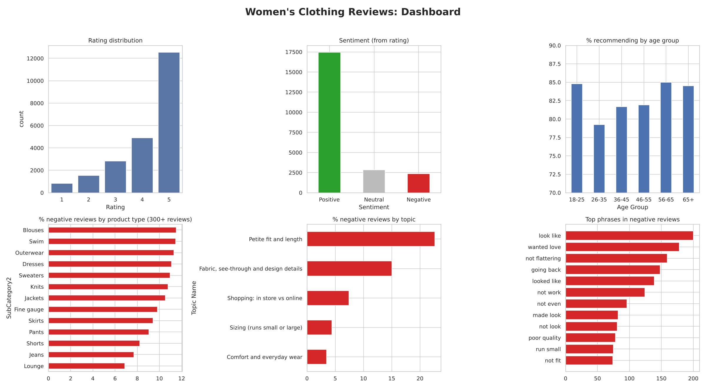
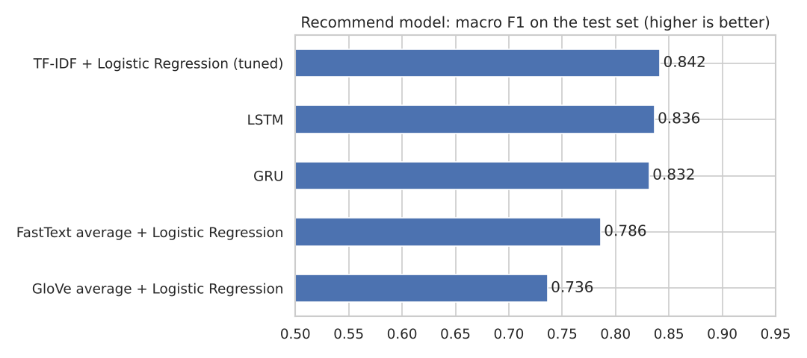
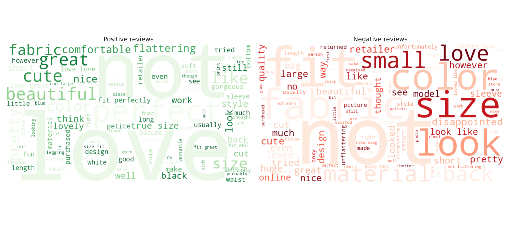

# Women's Clothing Reviews: NLP Project

Reading 22,628 customer reviews of a women's clothing shop with NLP to find out what customers like, what they complain about, and who recommends the products.

## Result
- A text model (TF-IDF + Logistic Regression) predicts if a customer **recommends** the product with **90% accuracy** and a **macro F1 of 0.84**. It finds 78% of the unhappy "not recommend" customers.
- The **star rating** can be guessed from the review text with an average miss of **0.47 stars**. The guess is within 1 star **93%** of the time.
- The biggest complaints are **petite fit and length** (23% negative) and **thin or see-through fabric** (15% negative).
- **Location and channel do not matter.** The problems are about the product, not about who the customer is.



## Problem
A women's clothing e-commerce company wants to understand its customers from their reviews:
1. What do happy and unhappy customers talk about?
2. How does sentiment change by category, product, location, channel and age group?
3. What drives customers to recommend a product?
4. Can we predict the rating from the review?
5. What are the main themes (topics) in the reviews?

## Dataset
23,486 reviews with 11 columns: Product ID, Category, Subcategory (2 levels), Location, Channel (web or mobile), Customer Age, Review Title, Review Text, Rating (1 to 5) and Recommend Flag (1 = yes). The data was given as a course case study. The public version of the same reviews is on Kaggle ([Women's E-Commerce Clothing Reviews](https://www.kaggle.com/datasets/nicapotato/womens-ecommerce-clothing-reviews)).

## Steps
1. **Data quality:** dropped 845 reviews with no text and 14 with no category, removed 3 duplicates, fixed a spelling mistake ("Initmates"), removed Excel line-break codes (`_x000D_`). Outlier check on age and review length with the IQR rule (kept the 108 customers over 79: rare but real).
2. **EDA:** ratings, recommend rate, channel, location, age and subcategory.
3. **Text cleaning pipeline:** lower case, expanding contractions (don't to do not), regex to remove special characters and numbers, removing extra spaces, tokenisation, stopword removal (keeping "not", "no", "never"), **stemming vs lemmatization** (used lemmatization).
4. **Sentiment:** compared VADER with the customer's own rating. VADER called **60% of 1-star reviews "positive"**, so the rating-based sentiment was used.
5. **Word clouds, top words and bigrams** for positive vs negative reviews.
6. **Sentiment by group:** category, subcategory, product type, single Product ID, location, channel, age group.
7. **POS tagging:** most used adjectives in positive vs negative reviews.
8. **NER:** tested Named Entity Recognition (finds few real names in clothing reviews).
9. **Text to numbers:** Count Vectorizer vs TF-IDF, n-grams, min_df.
10. **Recommend model:** Logistic Regression, Linear SVM and Complement Naive Bayes with 5-fold cross validation, then GridSearchCV. Balanced class weights because only 18% do not recommend.
11. **Word embeddings:** pre-trained **GloVe** (Wikipedia) and **FastText** trained on the reviews.
12. **Deep learning:** **LSTM** and **GRU** models with TensorFlow / Keras.
13. **Drivers from customer details:** a model with only age group, category, subcategory, channel and location.
14. **Rating prediction:** classification vs Ridge regression.
15. **Topic mining:** LDA, number of topics chosen with an NPMI coherence score (best = 5), topics named and linked to ratings.
16. **Dashboard:** one summary picture and an interactive HTML dashboard (`dashboard.html`, made with Plotly).

## Recommend model comparison (same test set, 4,526 reviews)
| Model | Macro F1 |
|---|---|
| **TF-IDF + Logistic Regression (tuned, final)** | **0.842** |
| LSTM | 0.836 |
| GRU | 0.832 |
| FastText average + Logistic Regression | 0.786 |
| GloVe average + Logistic Regression | 0.736 |
| Customer details only (age, category, city, channel) | 0.458 |

Simple TF-IDF + Logistic Regression was the best, and also the fastest and easiest to explain. LSTM and GRU came close. Averaging word vectors (GloVe, FastText) loses words like "not", so those models were weaker.



## Topics found
| Topic | Reviews | Avg rating | Recommend | Negative |
|---|---|---|---|---|
| Petite fit and length | 6,793 | 3.46 | 60% | 22.6% |
| Fabric, see-through and design details | 1,681 | 3.97 | 76% | 15.0% |
| Shopping: in store vs online | 1,511 | 4.50 | 89% | 7.4% |
| Sizing (runs small or large) | 3,561 | 4.47 | 92% | 4.4% |
| Comfort and everyday wear | 9,082 | 4.60 | 94% | 3.5% |



## Key findings
- Customers are mostly happy: average rating 4.2 and 82% recommend.
- Negative phrases: *"wanted love"*, *"not flattering"*, *"going back"*, *"poor quality"*, *"not fit"*.
- **Trend** items (18% negative), blouses, swimwear and dresses get the most complaints. Jeans and lounge wear get the fewest.
- Customers aged **26-35** are the most critical (79% recommend vs 85% for 18-25 and 56-65).
- A few products (IDs 1084, 870, 1087) have more than 20% negative reviews.

## Recommendations
- Fix petite sizing and length, and show exact measurements for petite items.
- Show fabric thickness / see-through information and real-life photos on product pages.
- Add size advice ("runs small, order one size up") where reviews keep saying so.
- Use the recommend model to flag new negative reviews so the customer team can reply quickly.

## What I learned
- The full NLP cleaning pipeline, and why to keep "not" when removing stopwords.
- Ready-made sentiment tools (VADER) can be badly wrong on a new topic.
- With about 18,000 reviews, simple TF-IDF models can beat word embeddings and deep learning.
- Topic mining needs human judgement: remove generic words, test the number of topics, then name them.

## Files
| File | What it is |
|---|---|
| `clothing_reviews_nlp.ipynb` | The full notebook, with outputs |
| `womens_clothing_reviews.xlsx` | The data |
| `dashboard.html` | Interactive dashboard (download and open in a browser) |
| `01_...png` to `13_...png` | Charts used in this README and the notebook |
| `requirements.txt` | Python libraries needed |

## How to run
```
pip install -r requirements.txt
jupyter notebook clothing_reviews_nlp.ipynb
```
The notebook downloads the NLTK data and the GloVe vectors (about 130 MB) the first time. A full run takes about 15 to 30 minutes on a laptop (topic mining and LSTM are the slow parts).

## Tools
Python, pandas, NLTK, scikit-learn, gensim (GloVe, FastText), TensorFlow / Keras (LSTM, GRU), WordCloud, matplotlib, seaborn, Plotly.
